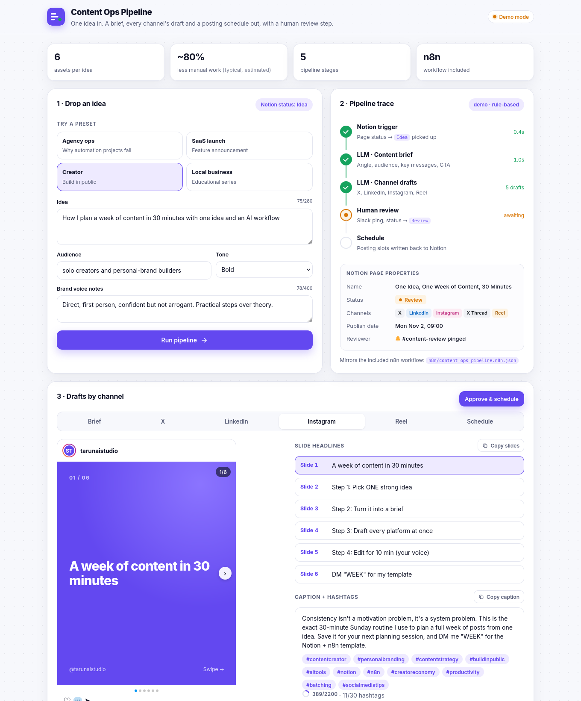
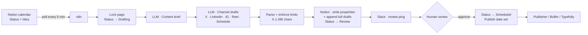
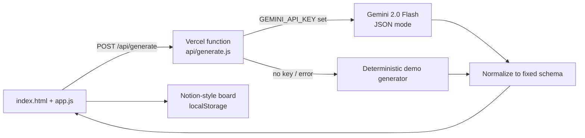

# Content Ops Pipeline

**One idea in. A content brief, every channel's draft and a posting schedule out, with a human review step before anything is scheduled.**

🔗 **Live demo:** https://content-ops-pipeline.vercel.app
🧩 **n8n workflow:** [`n8n/content-ops-pipeline.n8n.json`](n8n/content-ops-pipeline.n8n.json)



This is the open demo behind the **Content Operations Automation** case study on [saitarun.com](https://saitarun.com): an end-to-end pipeline from idea to publication built on **n8n, Notion and an LLM**. Typical impact: around **80% less manual work** in drafting, reformatting and copy-pasting (estimate, varies by team).

---

## Problem → Solution → Business impact

**The problem.** Small marketing teams, agencies and solo creators get one good idea and then spend hours turning it into five platform-native formats. Each format has its own rules (X's 280 characters, LinkedIn's "see more" fold, a 6-slide carousel, a 30-second reel). The calendar lives in Notion, drafts live in Google Docs, approvals live in Slack DMs, and nobody can see what is stuck.

**The solution.** A pipeline that treats content as a workflow:

1. A page in the Notion content calendar is set to **Idea**.
2. An LLM writes a **content brief**: angle, audience, key messages, proof points, CTA.
3. A second LLM step writes **native drafts** for X (post + 3-post thread), LinkedIn, Instagram (6-slide carousel + caption + hashtags) and a 30-second **Reel script** with three hook options, plus a **suggested posting schedule**.
4. Platform limits are enforced, everything is written back to the Notion page, and status moves to **Review**.
5. A reviewer gets a **Slack ping**, edits in Notion and moves the page to **Scheduled**.

**Business impact (typical, estimated; measure your own baseline):**

| Metric | Before | After |
|---|---|---|
| Time from idea to 5 reviewed drafts | 2–4 hours | ~15–20 min of human editing |
| Manual drafting / reformatting work | 100% | ~20% (review and polish only) |
| Visibility | Scattered docs and DMs | One Notion board with status per asset |
| Missed posting slots | Common | Every asset has a slot before approval |

---

## Architecture



The web demo mirrors this flow in the browser:



---

## Features

- **One input, six assets**: idea + audience + tone + brand voice notes → brief, X post, X thread, LinkedIn post, Instagram carousel, Reel script, schedule.
- **Four presets** (agency ops, SaaS launch, creator, local clinic) so one click shows a full result.
- **Platform-style previews**: X post and thread cards, LinkedIn post with the real "…see more" fold, swipeable Instagram carousel, phone-frame Reel player that steps through the script beat by beat.
- **Copy buttons and character counters** on every asset (X 280, LinkedIn 3,000, Instagram caption 2,200, hashtags 30).
- **Animated pipeline trace**: Notion trigger → brief → drafts → human review → schedule, with timings, plus the Notion page properties the workflow would write.
- **Human-in-the-loop**: drafts land in **Review**; nothing is scheduled until you click **Approve & schedule**.
- **Notion-style content calendar**: Idea → Drafting → Review → Scheduled → Published. Drag between columns (or use arrows on touch). Saved in `localStorage`.
- **Live AI or demo mode**: works fully without any API key; the header badge shows which mode served the result.
- **Importable n8n workflow** with sticky notes, retries and no secrets.

## How it works

1. `index.html` collects the idea and calls `POST /api/generate` with `{ idea, audience, tone, voice }`.
2. `api/generate.js` validates and trims input (idea ≤ 280, audience ≤ 160, voice ≤ 400 chars), applies a light per-IP rate limit, then:
   - with `GEMINI_API_KEY`: calls Gemini 2.0 Flash in JSON mode, then **normalizes** the output to a fixed schema (fills gaps, trims X copy to 280 chars);
   - without a key or on any error: returns a realistic **deterministic demo** package (curated for the four presets, templated for anything else) with `mode: "demo"`.
3. The UI renders each channel tab, adds one card per scheduled asset to the board in **Review**, and waits for approval.

Response shape (abridged):

```json
{
  "mode": "live | demo",
  "brief": { "title": "", "angle": "", "objective": "", "audience": "", "keyMessages": [], "proofPoints": [], "cta": "", "keywords": [], "pillar": "" },
  "x": { "post": "", "thread": ["", "", ""] },
  "linkedin": { "post": "" },
  "instagram": { "slides": ["", "", "", "", "", ""], "caption": "", "hashtags": [] },
  "reel": { "hooks": [], "script": [{ "t": "0-3s", "visual": "", "voiceover": "" }], "onScreenText": [], "cta": "", "audio": "" },
  "schedule": [{ "channel": "LinkedIn", "day": "Tue", "time": "09:00", "why": "" }]
}
```

## Tech stack

- **Front end**: vanilla HTML, CSS and JavaScript (ES modules). No framework, no build step. Inter via Google Fonts.
- **API**: one Vercel Node.js serverless function, zero dependencies, global `fetch`.
- **AI**: Google Gemini 2.0 Flash (REST, JSON response mode) in the demo; OpenAI chat completions in the n8n workflow. Both are swappable.
- **Automation**: n8n (Schedule Trigger, HTTP Request, Split Out, Set, Code), Notion API, Slack incoming webhooks.

## Project structure

```
content-ops-pipeline/
├── index.html
├── assets/
│   ├── style.css
│   └── app.js
├── api/
│   ├── generate.js        # POST /api/generate
│   └── _presets.js        # curated demo packages (not a route)
├── n8n/
│   └── content-ops-pipeline.n8n.json
├── docs/
│   └── screenshot.png
├── package.json
├── vercel.json
└── LICENSE
```

## Run locally

```bash
git clone https://github.com/saitarun29work-cmd/content-ops-pipeline
cd content-ops-pipeline
npx vercel dev
# open http://localhost:3000
```

No `npm install` needed. Without a key it runs in **Demo mode**. To use live AI, create `.env.local` with `GEMINI_API_KEY=...` and restart.

## Deploy

[](https://vercel.com/new/clone?repository-url=https://github.com/saitarun29work-cmd/content-ops-pipeline&env=GEMINI_API_KEY)

Zero config: Vercel serves the static files and turns `api/generate.js` into a serverless function.

## Environment variables

| Variable | Where | Required | Purpose |
|---|---|---|---|
| `GEMINI_API_KEY` | Vercel | No | Enables Live AI. Without it the app runs in Demo mode. Never sent to the browser. |

## n8n workflow

Import [`n8n/content-ops-pipeline.n8n.json`](n8n/content-ops-pipeline.n8n.json) via **Workflows → Import from file**.

**Flow:** Every 5 min → Notion query (`Status = Idea`) → one item per page → map properties → lock page (`Drafting`) → LLM brief → LLM channel drafts → parse + enforce limits → update Notion properties (`Review`) → append full drafts as page blocks → Slack review ping.

**Environment variables on your n8n instance** (no secrets live in the file):

| Variable | Purpose |
|---|---|
| `NOTION_TOKEN` | Notion internal integration secret (share the database with the integration) |
| `NOTION_DATABASE_ID` | Content calendar database |
| `OPENAI_API_KEY` | LLM calls |
| `OPENAI_MODEL` | Optional, defaults to `gpt-4o-mini` |
| `SLACK_WEBHOOK_URL` | Incoming webhook for the review channel |
| `BRAND_VOICE_DEFAULT` | Optional fallback brand voice |

If your instance blocks `$env` in nodes, set `N8N_BLOCK_ENV_ACCESS_IN_NODE=false` or replace the headers with n8n credentials.

**Notion database properties:** `Name` (title), `Status` (status: Idea, Drafting, Review, Scheduled, Published), `Audience` (text), `Tone` (select), `Brand voice` (text), `Brief`, `X Post`, `X Thread`, `LinkedIn`, `IG Carousel`, `Reel Script`, `Schedule` (text), `Channels` (multi-select), `Publish date` (date).

## Roadmap

- [ ] Publisher workflow: post `Scheduled` pages at their `Publish date` (X API, LinkedIn API, Instagram Graph API or Buffer)
- [ ] Slack interactive buttons: approve or request changes straight from the review ping
- [ ] Brand-voice memory: learn from edits made during review
- [ ] Image generation for carousel slides and reel thumbnails
- [ ] Performance feedback loop: pull post analytics back into Notion to tune the schedule

## Author

**Sai Tarun Ronanki**, AI Systems & Agentic Workflows Builder, Hyderabad

- Website: [saitarun.com](https://saitarun.com)
- LinkedIn: [linkedin.com/in/ronanki-sai-tarun](https://linkedin.com/in/ronanki-sai-tarun)
- X: [@SaiTarunRonanki](https://x.com/SaiTarunRonanki)
- Instagram: [@tarunaistudio](https://instagram.com/tarunaistudio)
- GitHub: [saitarun29work-cmd](https://github.com/saitarun29work-cmd)
- Email: [hello@saitarun.com](mailto:hello@saitarun.com)

💬 **Want a pipeline like this for your team?** [Discuss your workflow on WhatsApp](https://wa.me/918008941430?text=Hello%20Sai%20Tarun%20Ronanki,%20I%20want%20to%20discuss%20about%20my%20workflow)

## License

MIT © 2026 Sai Tarun Ronanki
