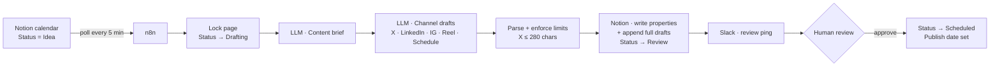

<div align="center">

<h1>Content Ops Pipeline</h1>

<p>One idea in. A content brief, native drafts for every channel and a posting schedule out, with a human review step before anything is scheduled.</p>

<p>
  <a href="https://content-ops-pipeline.vercel.app"></a>
  <a href="n8n/content-ops-pipeline.n8n.json"></a>
  <a href="LICENSE"></a>
  
  
</p>

<p>
  <a href="https://content-ops-pipeline.vercel.app"><b>Live demo</b></a> ·
  <a href="#n8n-workflow"><b>n8n workflow</b></a> ·
  <a href="#how-it-works"><b>Architecture</b></a> ·
  <a href="#run-locally"><b>Run locally</b></a>
</p>

</div>


## Overview

Small marketing teams, agencies and solo creators get one good idea, then spend hours rewriting it into five platform-native formats while the calendar, drafts and approvals live in different tools. This pipeline treats content as a workflow: an idea in a Notion calendar becomes a brief, channel drafts and a schedule, and waits in Review until a person approves it.

It is the open demo behind the Content Operations Automation case study on [saitarun.com](https://saitarun.com), built on n8n, Notion and an LLM.

## Highlights

- **One input, six assets.** Idea, audience, tone and brand voice become a brief, X post, X thread, LinkedIn post, Instagram carousel, Reel script and schedule.
- **Platform-style previews.** X cards, LinkedIn with the "see more" fold, a swipeable 6-slide carousel and a phone-frame Reel player that steps through the script.
- **Limits enforced.** Character counters and copy buttons on every asset: X 280, LinkedIn 3,000, Instagram caption 2,200, 30 hashtags.
- **Human in the loop.** Drafts land in Review. Nothing is scheduled until you click Approve & schedule.
- **Notion-style calendar.** Idea, Drafting, Review, Scheduled, Published. Drag between columns or use arrows on touch, saved in `localStorage`.
- **Live AI or demo mode.** Runs fully without an API key. The header badge shows which mode served the result.

## How it works



1. A page in the Notion content calendar is set to **Idea**. n8n picks it up and locks it as **Drafting**.
2. An LLM writes the brief: angle, objective, audience, key messages, proof points, CTA and pillar.
3. A second LLM step writes native drafts for X, LinkedIn, Instagram and a 30-second Reel (with three hook options), plus a suggested posting schedule.
4. Limits are enforced, everything is written back to the Notion page, and the status moves to **Review** with a Slack ping.
5. A reviewer edits in Notion and moves the page to **Scheduled**.

The web demo mirrors this in the browser. `index.html` calls `POST /api/generate`, which validates input (idea 8 to 280 characters, audience 160, tone 40, voice 400), applies a best-effort rate limit of 12 requests per minute per IP, then calls Gemini 2.0 Flash in JSON mode when `GEMINI_API_KEY` is set. Without a key, or on any error, it returns a deterministic demo package (curated for the four presets, templated otherwise). Both paths are normalized to one fixed schema.

## Business impact

Typical and estimated, not measured. Measure your own baseline.

| Metric | Before | After |
|---|---|---|
| Idea to 5 reviewed drafts | 2 to 4 hours | About 15 to 20 min of human editing |
| Manual drafting and reformatting | 100% | About 20% (review and polish only) |
| Visibility | Scattered docs and DMs | One Notion board with status per asset |
| Missed posting slots | Common | Every asset has a slot before approval |

## Tech stack

| Layer | Tools |
|---|---|
| Front end | Vanilla HTML, CSS and JavaScript (ES modules), no framework, no build step |
| API | One Vercel Node.js serverless function, zero dependencies, global `fetch` |
| AI | Gemini 2.0 Flash in the demo, OpenAI chat completions in n8n (default `gpt-4o-mini`) |
| Automation | n8n (Schedule Trigger, HTTP Request, Split Out, Set, Code) |
| Integrations | Notion API, Slack incoming webhooks |

## Project structure

```
content-ops-pipeline/
├── index.html
├── assets/
│   ├── app.js             # UI, previews, board
│   ├── lib.js             # pure helpers (limits, counters)
│   └── style.css
├── api/
│   ├── generate.js        # POST /api/generate
│   └── _presets.js        # curated demo packages (not a route)
├── n8n/
│   └── content-ops-pipeline.n8n.json
├── docs/
│   └── screenshot.png
├── package.json
├── vercel.json
└── LICENSE
```

## Run locally

```bash
git clone https://github.com/Saitarun29/content-ops-pipeline
cd content-ops-pipeline
npx vercel dev
# open http://localhost:3000
```

No `npm install` and no keys needed. It runs in demo mode until you add `GEMINI_API_KEY` to `.env.local` and restart.

## Configuration

| Variable | Required | Purpose |
|---|---|---|
| `GEMINI_API_KEY` | No | Enables live AI on Vercel. Without it the app runs in demo mode. Never sent to the browser. |

## n8n workflow

File: [`n8n/content-ops-pipeline.n8n.json`](n8n/content-ops-pipeline.n8n.json). No secrets live in the file.

1. In n8n, open **Workflows → Import from file** and select the JSON.
2. Set these environment variables on your instance: `NOTION_TOKEN`, `NOTION_DATABASE_ID`, `OPENAI_API_KEY`, `SLACK_WEBHOOK_URL`, and optionally `OPENAI_MODEL` (defaults to `gpt-4o-mini`) and `BRAND_VOICE_DEFAULT`. If your instance blocks `$env` in nodes, set `N8N_BLOCK_ENV_ACCESS_IN_NODE=false` or switch the headers to n8n credentials.
3. Create the Notion database with `Name` (title), `Status` (Idea, Drafting, Review, Scheduled, Published), `Audience`, `Tone` (select), `Brand voice`, `Brief`, `X Post`, `X Thread`, `LinkedIn`, `IG Carousel`, `Reel Script`, `Schedule`, `Channels` (multi-select) and `Publish date` (date), then share it with your integration.
4. Activate the workflow. It polls every 5 minutes for pages with `Status = Idea`.

## Deploy

[](https://vercel.com/new/clone?repository-url=https://github.com/Saitarun29/content-ops-pipeline&env=GEMINI_API_KEY)

Zero config. Vercel serves the static files and turns `api/generate.js` into a serverless function.

## Roadmap

- Publisher workflow that posts `Scheduled` pages at their `Publish date` (X, LinkedIn, Instagram Graph API or Buffer)
- Slack interactive buttons to approve or request changes from the review ping
- Brand-voice memory that learns from edits made during review
- Performance feedback loop that pulls post analytics back into Notion to tune the schedule

---

<div align="center">

Built by **Sai Tarun Ronanki** · AI Systems & Agentic Workflows Builder · Hyderabad

[saitarun.com](https://saitarun.com) · [LinkedIn](https://linkedin.com/in/ronanki-sai-tarun) · [X](https://x.com/SaiTarunRonanki)

**[Discuss your workflow →](https://wa.me/918008941430?text=Hello%20Sai%20Tarun%20Ronanki,%20I%20want%20to%20discuss%20about%20my%20workflow)**

MIT © 2026 Sai Tarun Ronanki

</div>
